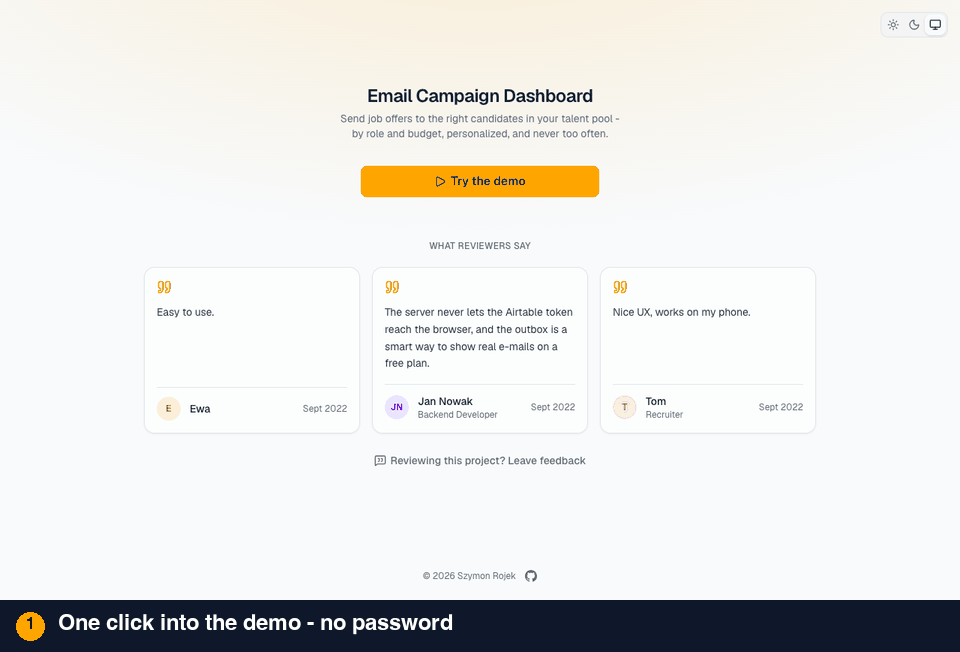
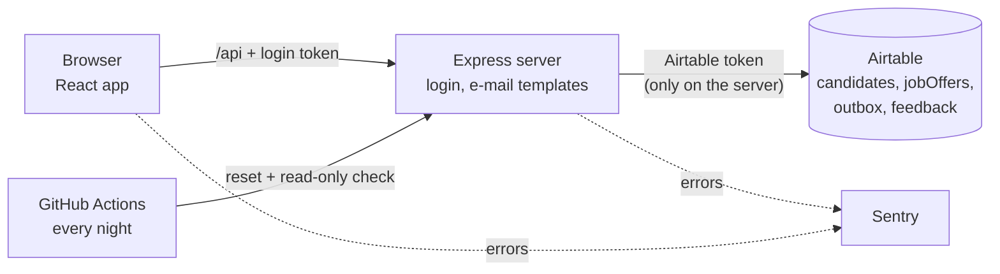

<div align="center">

# Talent Outreach

**Send job offers to the right candidates in your talent pool - by role and budget, personalized, and never too often.**

A side project from 2021, rebuilt in 2026 to production standard: full-stack TypeScript, tests on every level, CI/CD, staging and production.

[](https://github.com/SzymonRojek/talent-outreach/actions/workflows/ci.yml)
[](https://talent-outreach.onrender.com/)
[](#testing-and-quality)
[](postman/)


[**Live demo**](https://talent-outreach.onrender.com/) · one click on **Try the demo**, no password needed

</div>

<p align="center">
  
</p>

## Contents

- [Live demo](#live-demo)
- [The problem it solves](#the-problem-it-solves)
- [Highlights](#highlights)
- [Features](#features)
- [Tech stack](#tech-stack)
- [Architecture](#architecture)
- [Testing and quality](#testing-and-quality)
- [Running locally](#running-locally)
- [Project structure](#project-structure)
- [Git workflow and deployment](#git-workflow-and-deployment)
- [History](#history)

## Live demo

| environment | link | API password (Postman) |
| --- | --- | --- |
| **Production** | [talent-outreach.onrender.com](https://talent-outreach.onrender.com/) | `admin` |
| Staging (newest changes) | [talent-outreach-staging.onrender.com](https://talent-outreach-staging.onrender.com/) | `admin` |

> [!NOTE]
> **Demo mode** - nobody really gets the e-mails. Sending builds a real, personalized e-mail for every candidate and saves it in the job offer's outbox, where each one can be opened. Feel free to change anything: the example data comes back every night. Please use made-up data - the demo is public.
>
> Free hosting: after a break, the first load can take up to a minute.

> [!TIP]
> **Reviewing the project?** I would love your feedback - use "Leave feedback" on the start page or in the app.

## The problem it solves

A small recruitment agency or a freelance recruiter keeps candidates in a spreadsheet. Sending a new job offer means: filter the sheet by role and salary, copy the addresses into Gmail, write "Dear candidate" to everyone, and hope that nobody gets the same kind of offer twice in a week. Put the addresses in CC instead of BCC by mistake, and everybody sees everybody else's e-mail - a data leak.

| step | spreadsheet + Gmail | Talent Outreach |
| --- | --- | --- |
| who gets the offer | filter the sheet by hand, copy the addresses | pick a **role** and a **budget** - the matching candidates are found |
| the message | "Dear candidate" for everyone | `{{name}}` and `{{role}}` - every candidate gets their own e-mail |
| too many offers | nobody remembers who got what | candidates **contacted in the last 14 days are skipped** by default; the list shows **last contacted** |
| consent (GDPR) | a column nobody updates | only candidates **open to offers** get them; an **opt-out link** in every e-mail updates the status by itself |
| other people's addresses | CC by mistake = a leak | one e-mail per candidate - nobody sees the others |
| what was sent | the Sent folder | an outbox per job offer: who got it and every e-mail exactly as it was sent |

## Highlights

- **Full-stack TypeScript** - React client and Express server, strict mode on both sides
- **Secure by design** - the Airtable token never reaches the browser; signed login tokens, protection against password guessing, signed opt-out links, user text always escaped in the e-mails
- **Tested on every level** - 144 server and 102 client unit tests, 63 end-to-end tests in a real browser, a Postman collection of API tests and a Lighthouse audit - all in CI on every pull request
- **Production-ready** - staging and production with automatic deploys, error monitoring (Sentry) without personal data, a nightly demo reset followed by a read-only check of the live app
- **Product thinking** - one recruiter problem solved end to end, a preview before every send, no lost work, minimal noise in the UI, accessible (Lighthouse accessibility 100), works on phones

## Features

<table>
  <tr>
    <th align="left" width="33%">Candidates</th>
    <th align="left" width="33%">Job offers</th>
    <th align="left" width="34%">Everywhere</th>
  </tr>
  <tr valign="top">
    <td>
      <ul>
        <li>role, expected salary and <b>last contacted</b> in the list</li>
        <li>statuses: open to offers, awaiting consent, do not contact, opted out</li>
        <li>search (also without accents and by role), status filter, sorting</li>
        <li>details, adding and editing in a side panel over the list</li>
        <li>each candidate's panel lists the job offers they got</li>
        <li>one e-mail address = one candidate, checked on both sides</li>
        <li>CSV import with a preview that validates every row; CSV export</li>
      </ul>
    </td>
    <td>
      <ul>
        <li>recipients by <b>role</b> and <b>budget</b>; the ones contacted in the last 14 days are skipped; fine-tuning by hand</li>
        <li><code>{{name}}</code> / <code>{{surname}}</code> / <code>{{role}}</code> in the subject and the message; a mistyped placeholder is caught</li>
        <li>drafts, duplicating</li>
        <li>preview before sending, for any recipient</li>
        <li>outbox: who got it, every e-mail as it was sent; CSV export</li>
        <li>an opt-out link in every e-mail (a public page)</li>
      </ul>
    </td>
    <td>
      <ul>
        <li>one click into the demo</li>
        <li>dashboard with the key numbers</li>
        <li>feedback from reviewers, shown after approval</li>
        <li>unsaved changes are never lost without asking</li>
        <li>light / dark / system theme; phones: the lists become cards</li>
      </ul>
    </td>
  </tr>
</table>

## Tech stack

| area | technologies |
| --- | --- |
| **Frontend** | React 19, TypeScript, Vite, Tailwind CSS, shadcn/ui (Radix), React Router 7, TanStack Query, React Hook Form + Yup |
| **Backend** | Node.js 24, Express, TypeScript, Airtable REST API |
| **Testing** | Jest + supertest, Vitest + React Testing Library, Playwright, Postman + Newman, Lighthouse |
| **DevOps** | GitHub Actions, Render (`render.yaml` Blueprint), Sentry |

## Architecture



- **The server is the only way to the data.** The React app never talks to Airtable; the Express server keeps the token in environment variables and returns only the data.
- **Login** - every data endpoint needs a signed token valid for 8 hours. In the browser, "Try the demo" gets it from `POST /api/auth/demo` with one click - the endpoint exists only with `DEMO_LOGIN=true`, so no other server has a door without a password. API clients (Postman) get the same token from `POST /api/auth/login` with the password; after 5 wrong passwords the visitor's address (the real one, behind Cloudflare) is blocked for 15 minutes.
- **Choosing the recipients** - the browser finds them: the role and the budget filter the candidates open to offers, and "last contacted" comes from the outbox (`GET /api/outbox`), so the ones who got an offer in the last 14 days are skipped by default.
- **Sending** - the server still has the last word: it sends only to candidates open to offers, builds one e-mail per recipient from a template (fills in the name and the role, escapes the text, adds a signed opt-out link) and saves it in the outbox. The preview uses the same template.
- **Why an outbox** - the demo is public and the free hosting blocks outgoing SMTP. Where the e-mails go is one setting (`MAIL_TRANSPORT`): `outbox` on the demo, `ethereal` locally (a test SMTP server). A real e-mail service would be one more case.
- **Feedback** - public endpoints with a bot trap and a limit of 3 entries an hour per visitor; a new entry is never shown before it is approved in Airtable.
- **Error monitoring** - Sentry on both sides, only where `SENTRY_DSN` is set; no IP addresses, headers, bodies or clicks, and the opt-out token is removed from every address.

<details>
<summary><b>API endpoints</b></summary>

| method | endpoint | auth |
| ------ | -------- | ---- |
| `GET` | `/api/health` | - |
| `POST` | `/api/auth/login` | - |
| `POST` | `/api/auth/demo` | - (only with `DEMO_LOGIN=true`) |
| `GET`, `POST` | `/api/candidates` | token |
| `POST` | `/api/candidates/import` | token |
| `GET`, `PATCH`, `DELETE` | `/api/candidates/:id` | token |
| `GET` | `/api/candidates/:id/outbox` | token |
| `GET`, `POST` | `/api/job-offers` | token |
| `POST` | `/api/job-offers/preview` | token |
| `GET`, `PATCH`, `DELETE` | `/api/job-offers/:id` | token |
| `POST` | `/api/job-offers/:id/send` | token |
| `GET` | `/api/job-offers/:id/outbox` | token |
| `GET` | `/api/outbox` | token |
| `GET` | `/api/outbox/:id/preview` | token |
| `GET`, `POST` | `/api/opt-out/:token` | the signed link from the e-mail |
| `GET`, `POST` | `/api/feedback` | - (public; only approved feedback is listed) |
| `POST` | `/api/demo/reset` | reset key (production only) |

</details>

<details>
<summary><b>Nightly reset of the demo data</b></summary>

The demo is open to everyone ("Try the demo"), so visitors change the data. Every night a scheduled GitHub Action calls `POST /api/demo/reset` with a secret key. The server creates the examples from `server/demo/seedData.ts` - a talent pool of 12 candidates and 5 job offers, with dates counted back from today - and only then deletes the old records, so an error never leaves an empty table. The reset is skipped when nobody changed anything (unless the examples are older than 7 days), and the reviewers' feedback is never touched.

Right after the reset, the read-only "Smoke" folder of the Postman collection checks the live app - a broken demo fails the run and GitHub sends an e-mail.

</details>

## Testing and quality

Every pull request runs all of it in GitHub Actions: type checking, lint, unit tests, the production build, end-to-end tests, API tests and a Lighthouse audit - both the change on its own (into `dev`) and the release (`dev -> main`).

| layer | tools | what | scale |
| --- | --- | --- | --- |
| **Server unit** | Jest, supertest | every endpoint, login and limits, sending and templates with `{{role}}`, opt-out links, CSV import, feedback, demo reset, monitoring privacy | 144 tests |
| **Client unit** | Vitest, React Testing Library | validation, CSV, search / sort / filter, API client, login token storage, recipients by role / budget / last contacted, theme | 102 tests |
| **End-to-end** | Playwright | real user flows in a browser on the production build: candidates, job offers from draft to outbox, recipients by role and budget, opting out, feedback, unsaved changes, dark mode, phones | 63 tests |
| **API** | Postman, Newman | the collection in [`postman/`](postman/): login and refusals (401, 400), duplicate e-mail (409), draft → preview → send → second send (409) → outbox, feedback, clean-up | 30 requests, 56 assertions |
| **Lighthouse** | Lighthouse | 7 screens, logged out and in, desktop and phone; accessibility, best practices and SEO must stay at 100 | every PR |
| **Live demo** | Newman | read-only check of production after the nightly reset | every night |

The end-to-end, API and Lighthouse runs use a fake Airtable (`e2e/mock-airtable.ts`), so they never touch real data. On the live demo, the Postman collection skips every request that would change data.

**Use the collection in Postman:** import `postman/talent-outreach.postman_collection.json` and an environment from [`postman/`](postman/) - `Local` (fill in your password) or `Demo (read-only)`.

## Running locally

Needs **Node.js 24** and an Airtable base with four tables (all fields text, except where noted):

| table | fields |
| --- | --- |
| `candidates` | `name`, `surname`, `email`, `status` (single select: `open to offers`, `awaiting consent`, `do not contact`, `opted out`), `role`, `expectedSalary` (per month), `phone`, `date` |
| `jobOffers` | `subject`, `message` (long text), `status` (single select: `draft`, `sent`), `date` |
| `outbox` | `email`, `name`, `candidateId`, `jobOfferId`, `sentAt` |
| `feedback` | `name`, `role`, `message` (long text), `approved` (checkbox), `date` |

```bash
cp .env.example .env                          # fill in the values below
npm install && npm start                      # API on http://localhost:5000
cd client && npm install && npm start         # app on http://localhost:3000
```

<details>
<summary><b>Environment variables</b></summary>

| variable | where | value |
| --- | --- | --- |
| `AIRTABLE_BASE_ID` | `.env`, Render | the Airtable base ID (`app...`) |
| `AIRTABLE_TOKEN` | `.env`, Render | an Airtable personal access token with `data.records:read` / `write` for that base |
| `ADMIN_PASSWORD` | `.env`, Render | the password for `POST /api/auth/login` (API, Postman) |
| `AUTH_SECRET` | `.env`, Render | a random secret that signs the login tokens |
| `DEMO_LOGIN` | `.env`, Render | `true` - the "Try the demo" button logs in without the password; without it the app works only through the API |
| `MAIL_TRANSPORT` | `.env` (optional) | `outbox` (default) or `ethereal` |
| `SENTRY_DSN` | Render (optional) | the Sentry project's DSN - turns on error monitoring (the client reads it at build time) |
| `SENTRY_ENVIRONMENT` | Render | `production` or `staging` - set in `render.yaml` |
| `DEMO_RESET_KEY` | Render (production), GitHub secret | turns on the nightly reset - **production only**, it wipes the base |
| `DEMO_APP_URL` | GitHub variable | the address the nightly reset calls |

Only the server reads these - none of them reaches the browser (the Sentry DSN is public by design: it can only send errors).

</details>

<details>
<summary><b>Running the tests</b></summary>

| command | what |
| --- | --- |
| `npm run typecheck` | TypeScript (server + client) |
| `npm install --prefix server && npm test` | server unit tests |
| `cd client && npm test` | client unit tests |
| `npm run build && npm install --prefix e2e && npm run test:e2e` | end-to-end tests (on the production build) |
| `npm run build:server && npm run test:api` | API tests (Postman collection, Newman) |
| `npm run build && npm run test:lighthouse` | Lighthouse audit (needs Google Chrome) |

</details>

## Project structure

```text
client/          React app (Vite) - pages, components, hooks, shadcn/ui
server/          Express API - routes, controllers, e-mail templates, demo data, Sentry
e2e/             Playwright tests, the fake Airtable, the API test and Lighthouse runners
postman/         Postman collection and environments
docs/            the README GIF
.github/         CI and the nightly demo reset
render.yaml      production and staging on Render
```

## Git workflow and deployment

| branch | environment |
| ------ | ----------- |
| `main` | production |
| `dev`  | staging |

1. Every change starts on a short-lived branch off `dev` (`feature/...`, `fix/...`, `chore/...`).
2. Pull request into `dev` - CI must pass and there must be no conflicts, then a review and a merge; Render deploys staging.
3. After checking staging - a release pull request `dev -> main`: CI runs again on all the changes from `dev` together (they passed one by one, but not yet as a whole), then a merge commit; Render deploys production. There is no extra run after the merge - it would test the same code twice.

**Hotfix:** a `hotfix/...` branch off `main`, a pull request into `main`, then right away `main -> dev`, so both environments run the same code.

## History

The project started in 2021 as "Email Campaign Dashboard", a CRUD app that sent e-mails through EmailJS straight from the browser. In 2026 it was rebuilt step by step: TypeScript on both sides, a secure server, a new UI, automated tests on every level and CI/CD - and then turned from a generic newsletter tool into Talent Outreach, which solves one recruiter's problem: the right job offer to the right candidates, never too often.

---

<div align="center">
<sub>Built by <a href="https://github.com/SzymonRojek">Szymon Rojek</a></sub><br>
<sub>© 2021-2026 Szymon Rojek - shared for review, all rights reserved</sub>
</div>
